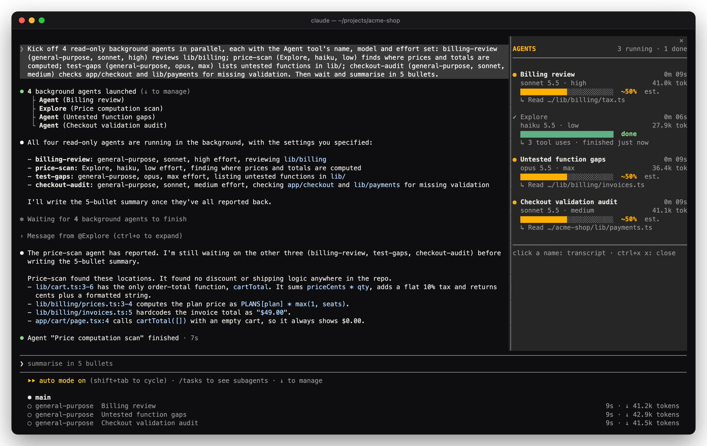
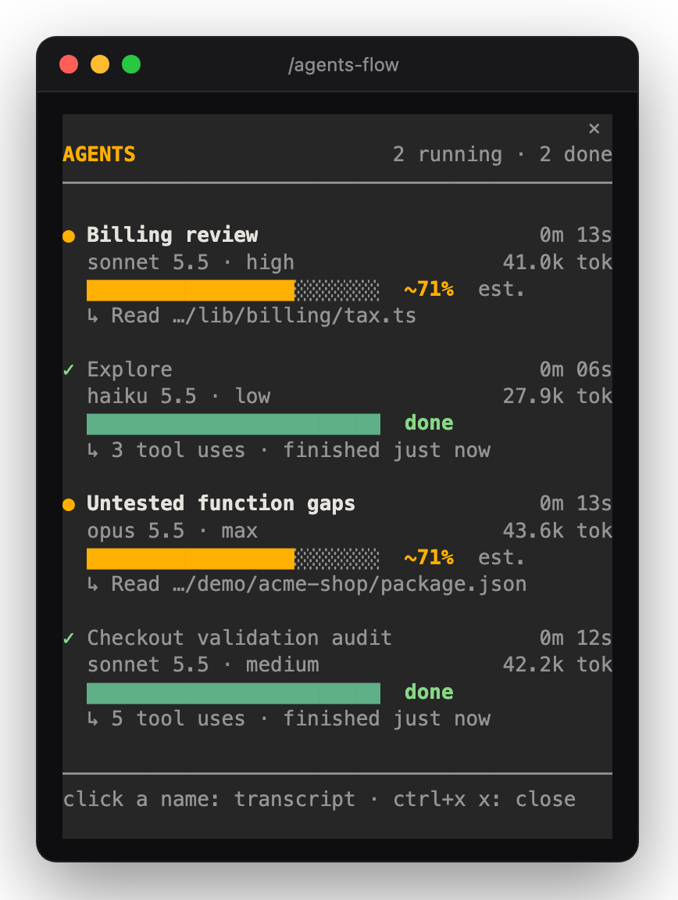
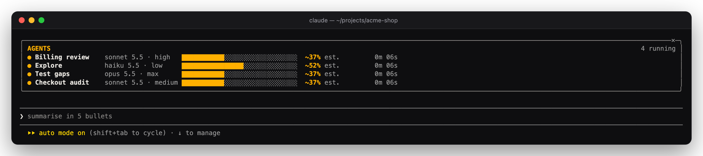

# agents-flow

A live side panel for [Claude Code](https://code.claude.com) that shows every agent working in your session. Each agent gets a block with its name, the model and effort it runs on, an amber progress bar, what it's doing right now, how long it has run, and how many tokens it holds.



## Install

At the Claude Code prompt:

```
/plugin install agents-flow --marketplace ludmal/agents-flow
```

Answer `y` to add the marketplace, then press Enter to install it for your user. From a shell instead:

```
claude plugin install agents-flow --marketplace ludmal/agents-flow
```

## Use

| To | Do |
| --- | --- |
| Open or close the panel | Type `/agents-flow`. It works mid-turn too. |
| Dock it on the right | Use fullscreen mode (`/tui fullscreen` once, or start Claude Code with `CLAUDE_CODE_NO_FLICKER=1`) in a terminal at least 110 columns wide. Otherwise the panel opens above the prompt with one line per agent. |
| Open an agent's transcript | Click its name. Or press `ctrl+x tab` to move into the panel, then Enter. |
| Close it | `/agents-flow` again, or `ctrl+x x`. |

## What a block shows



| Part | Meaning |
| --- | --- |
| `●` `◐` `✓` `✗` `■` `◌` | Running, waiting for your approval or a reply, done, failed, stopped, idle teammate. |
| Name | The agent's name, else its type (`Explore`, `developer`). A `general-purpose` agent goes by its task. |
| Title | The job the agent was given (`Fix web unit tests`), then the step it's on now from its own task or todo list (`· Running the web unit tests`). Not in fullscreen mode, the job sits beside the name. |
| `sonnet 5.5 · high` | The model and effort the agent's requests actually run with. |
| `41.0k tok` | Tokens in the agent's context. |
| Bar | The agent's own task list (`2/4 tasks`) when it keeps one. Otherwise an estimate from how long earlier runs of the same agent type took (`~71% est.`). With no history yet, or once it runs past its usual time, a dim moving shimmer that only means "working". |
| `↳` | The tool call it's making now. |

Agents started by another agent are indented under it. Finished agents stay for two minutes, dimmed, then leave. While the panel is closed, the status line under the prompt counts them: `● 2 agents running · 1 waiting · /agents-flow`.

Not in fullscreen mode, the panel opens above the prompt with one line per agent:



## Privacy: what it runs

agents-flow is a Claude Code mod: one TypeScript module of function hooks, readable in [`hooks/register.tsx`](hooks/register.tsx). It watches agent events in your session (spawns, model requests, tool calls, turn ends) and never changes or blocks any of them. It makes no network requests, reads none of your files and runs no commands. The only thing it keeps on disk is how long each agent type took on its last 10 runs, for the estimate, in its own plugin store under your Claude Code configuration folder.

## Requirements

Claude Code with mod (function hook) support. Tested on 2.1.325.

## Uninstall

```
/plugin uninstall agents-flow
```

## Develop

```
claude --plugin-dir ./agents-flow       # run it from a checkout
claude plugin validate ./agents-flow
claude plugin test ./agents-flow
```

## License

[MIT](LICENSE)
